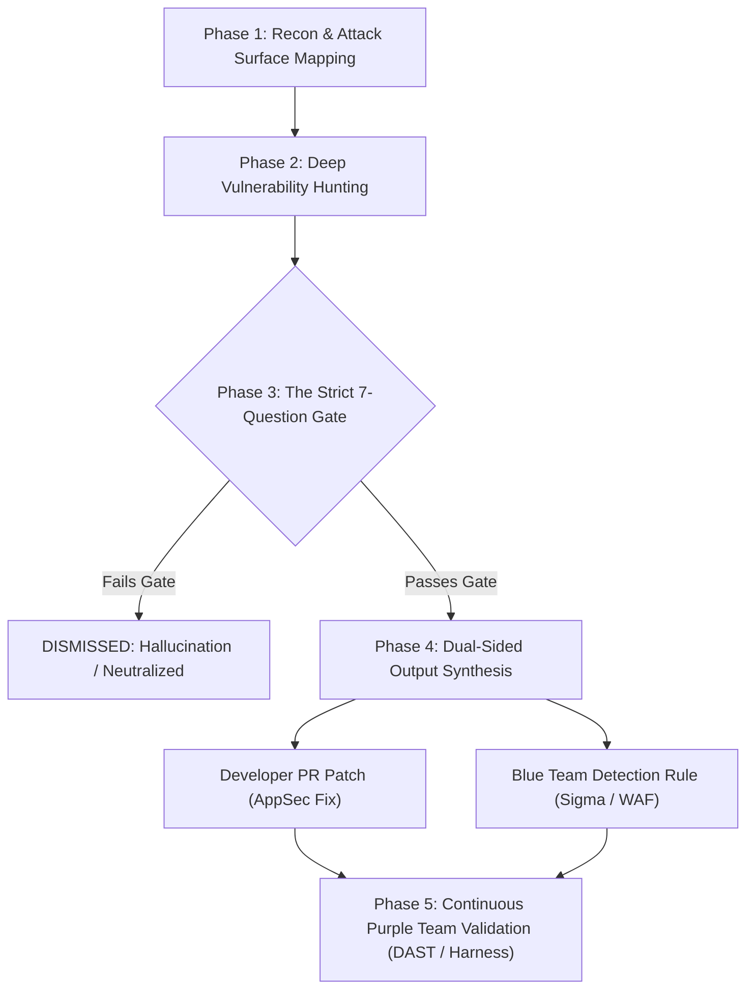
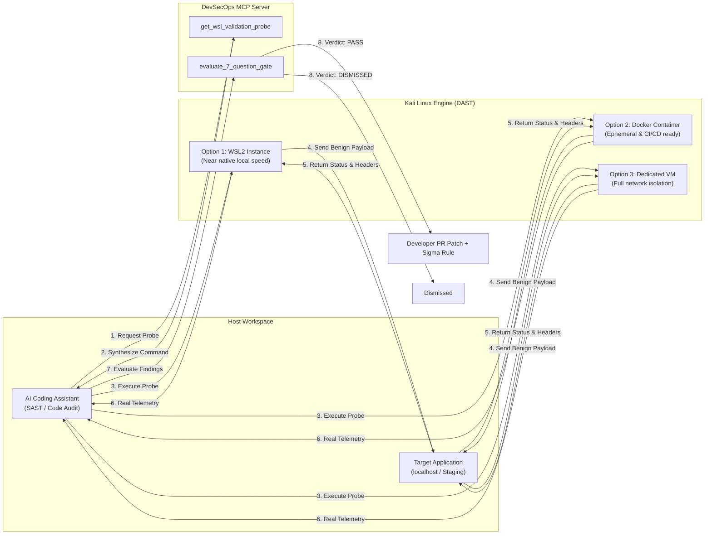

# 🛡️ Agentic DevSecOps Suite
### *Autonomous Purple-Team Engineering & Vulnerability Validation Framework for AI Coding Assistants*

<p align="center">
  
  
  
  
</p>

---

## 🌌 Overview

The **Agentic DevSecOps Suite** is an open-source, modular purple-team engineering framework designed to transform AI coding assistants (Google Antigravity, Cursor, Claude Code, GitHub Copilot, Windsurf) into **rigorous, empirically validated defensive security partners**.

Instead of relying on generic chat prompts that hallucinate false positives or produce theoretical vulnerability noise, this suite enforces a **5-Phase Closed-Loop Methodology** paired with **The Strict 7-Question Verification Gate**.



---

## 💡 How & Why This Suite Was Built

### The Problem With Traditional AI Code Auditing
When standard Large Language Models (LLMs) are asked to *"audit this codebase for security"*, they commonly suffer from two critical failures:
1. **Static AST Hallucinations & False Positives:** LLMs flag raw string patterns as critical SQLi or XSS even when underlying frameworks (such as React JSX auto-escaping, ORM parameter bindings, or Cloudflare Workers) completely neutralize the issue in practice.
2. **One-Sided, Non-Actionable Criticisms:** The assistant dumps a list of theoretical criticisms without providing tested root-cause code patches, automated regression tests, or telemetry detection rules for security operations.

### The Engineering Solution
Developed at **KYO INC** during high-assurance application audits, this framework was created to establish a **verifiable, zero-unverified-findings policy**:
* **Every finding must be validated in practice** (via live DAST probes or empirical validation test harnesses) before being reported.
* **Every accepted finding must produce dual-sided outputs**: an architectural code fix for the software engineer AND a Sigma / WAF detection rule for the blue team.

---

## 🎁 A Free, Modular Template: Adopt What Matters to You

> [!NOTE]
> **This repository is a free, MIT-licensed template.** You do **not** need to adopt the entire suite at once. 
> Modular by design, you can pick and choose only the specific skills and playbooks relevant to your stack and discard the rest.

### 🧭 Adoption Guide: What to Pick for Your Project

| Your Project Focus | What to Adopt | What You Can Skip |
| :--- | :--- | :--- |
| **Web Apps & REST/GraphQL APIs** | • `bug-hunting-recon-surface`<br>• `vuln-hunting-auth-access-control`<br>• `vuln-hunting-injection-rce` | Skip Active Directory & Cloud Infrastructure playbooks. |
| **CI/CD & Supply Chain Security** | • `devsecops-pipeline-automation.md`<br>• `bug-bounty-validator-gate`<br>• `threat-intel-skills-distiller` | Skip application-specific routing heuristics. |
| **SOC & Incident Response Readiness** | • `incident-response-playbooks`<br>• `detection-rules-starter-reference.md`<br>• `devsecops-defense-playbooks.md` | Skip static source code reconnaissance. |
| **AI Assistants with MCP Support** | • `.agents/mcp/server.js`<br>• `devsecops-mcp-kb` | Run the MCP server to give your LLM live tool access to 20+ vulnerability classes. |

---

## ⚖️ What to Adopt vs. What to Avoid

### ✅ Best Practices to Adopt:
* **Enforce the 7-Question Gate:** Never file a security ticket or commit a patch based solely on static code patterns. Ensure direct reachability, identify access prerequisites, and prove business impact.
* **Skill Transparency & Developer Approval Gate:** Autonomous agents must never silently or unilaterally activate audit skills or trigger inspection routines in the background. Before any skill is selected or executed, the agent must clearly explain to the developer *why* the skill is needed, *what* files or routes it will analyze, and *what* probes/tools it will run — requiring explicit developer sign-off (`Proceed / Reject`) before taking action.
* **Dual-Sided Output:** Always pair an AppSec code patch with a corresponding Blue Team detection rule (Sigma / log query / WAF signature).
* **Strict Remote Push Gate:** Never permit automated agents to push to remote git repositories without prior explicit user approval.
* **Defense-in-Depth Defaults:** Always mandate baseline security headers (`Helmet`/`CSP`), CORS origin allowlists, and rate-limiting on unauthenticated endpoints.

### 🚫 Anti-Patterns to Avoid:
* **Avoid Offensive-Only Weaponization:** Do not use AI agents to generate novel functional exploits or weaponized malware payloads against targets. Keep the scope strictly defensive, remediative, and detection-focused.
* **Avoid Monolithic Prompt Dumps:** Don't dump 50 pages of instructions into every prompt. Use specialized, on-demand skills (`SKILL.md`) that activate only when auditing relevant subsystems.
* **Avoid Hardcoded Secrets:** Never hardcode API keys, production tokens, or private credentials in agent configuration files or git history.

---

## 📁 Repository Structure

```text
agentic-devsecops-suite/
├── .agents/
│   ├── AGENTS.md                              # Core threat modeling, MITRE ATT&CK & defensive rules
│   ├── INDEX.md                               # Master reference sitemap & documentation index
│   ├── purple-team-vuln-class-matrix.md       # Comprehensive 20+ vulnerability class purple matrix
│   ├── purple-team-automation-methodology.md  # The 5-Phase operational methodology
│   ├── devsecops-pipeline-automation.md       # GitHub Actions CI/CD security gate blueprints
│   ├── devsecops-defense-playbooks.md         # Blue team defense & hardening guides
│   ├── detection-rules-starter-reference.md   # Baseline Sigma detection rules
│   ├── playbook-*.md                          # 7 Dedicated Incident Response Playbooks
│   │   ├── playbook-ad-compromise-response.md
│   │   ├── playbook-c2-beacon-response.md
│   │   ├── playbook-cloud-credential-compromise.md
│   │   ├── playbook-container-kubernetes-compromise.md
│   │   ├── playbook-phishing-response.md
│   │   ├── playbook-ransomware-response.md
│   │   └── playbook-web-app-exploitation.md
│   ├── mcp/
│   │   └── server.js                          # DevSecOps Knowledge Base MCP Server
│   ├── mcp_config.json                        # Portable Model Context Protocol configuration
│   └── skills/                                # Reusable Agent Skills (SKILL.md specs)
│       ├── bug-hunting-orchestrator/          # Master 5-phase orchestrator
│       ├── bug-hunting-recon-surface/         # Route & entry point discovery
│       ├── bug-bounty-validator-gate/         # 7-Question Gate triage filter
│       ├── vuln-hunting-auth-access-control/  # IDOR, JWT, OAuth, Mass Assignment
│       ├── vuln-hunting-injection-rce/        # SQLi, NoSQLi, Command Injection, SSTI
│       ├── vuln-hunting-network-ssrf-logic/   # SSRF, Path Traversal, CORS, TOCTOU
│       ├── threat-intel-skills-distiller/     # Ingest threat intel into Semgrep/Sigma
│       ├── incident-response-playbooks/       # Operational triage workflows
│       └── devsecops-mcp-kb/                  # MCP server interaction skill
├── .gitattributes                             # Normalized LF line endings
├── .gitignore                                 # Clean exclusion rules
├── CONTRIBUTING.md                            # Open-source contribution guidelines
├── LICENSE                                    # MIT License
├── package.json                               # MCP executable package definition
├── README.md                                  # You are here
└── SECURITY.md                                # Vulnerability reporting & security policy
```

---

## 🚀 Quickstart: Integrating Into Your Project

### 1. Drop Into Your Repository
Copy the `.agents/` folder into the root of your existing codebase:
```bash
cp -r .agents /path/to/your/project/
```

### 2. Configure Your AI Assistant
* **Antigravity / Cursor:** Point your agent customizations or workspace rules to `.agents/AGENTS.md`. The skills in `.agents/skills/*/SKILL.md` will be discovered and loaded dynamically on demand.
* **Model Context Protocol (MCP):** If your assistant supports MCP, register the DevSecOps knowledge server in your editor's MCP configuration. The MCP server exposes tools for vulnerability lookups, Kali DAST validation probes, 7-Question Gate evaluations, and the **Skill Approval Gate** (`explain_and_request_skill_approval`), ensuring your agent transparently explains and requests approval before executing any audit skill:
  ```json
  {
    "mcpServers": {
      "devsecops-knowledge": {
        "command": "node",
        "args": ["./.agents/mcp/server.js"]
      }
    }
  }
  ```

### 3. Prompting Your Assistant
You can invoke the workflow directly in conversation:
> *"Run the bug-hunting-orchestrator across our API endpoints to map our attack surface, inspect access controls, and evaluate any findings through the 7-Question Gate."*

---

## 🐉 Validating Findings with Kali Linux (WSL2, Docker & Virtual Machines)

> [!WARNING]
> ### ⚠️ Rules of Engagement & Authorization Notice
> **Only run network scanners, fuzzers, and dynamic probes (`nmap`, `ffuf`, `nuclei`, `curl`, etc.) against systems, networks, and applications that you own or for which you have explicit, written authorization to test.**
>
> While this suite is provided under the permissive MIT license, running scanners or active probes against third-party systems without prior authorization violates terms of service, acceptable use policies, and computer crime laws (such as the US CFAA or Brazilian Law 12.737/2012). All verification probes and tools in this framework are engineered strictly for first-party defensive testing on local loopback (`localhost`, `127.0.0.1`) and authorized private staging environments.

A core tenet of this framework is **Mandatory Empirical Validation**:
> *Never file a security bug or commit a patch based solely on static code pattern assumptions. Every finding must be empirically proven to trigger against a running environment, and every patch must be proven to neutralize it.*

By pairing the **DevSecOps MCP Server** (`get_wsl_validation_probe`) with **Kali Linux**, your AI assistant bridges the gap between static AST analysis (SAST) and live runtime verification (DAST). The assistant can generate targeted, non-destructive test probes, execute them against your local/staging environment, and feed the live HTTP responses directly into the **7-Question Gate**.



### 🛠️ Execution Options: WSL2 vs. Docker vs. VMs

You can run Kali Linux alongside this suite using whichever virtualization model fits your development and infrastructure workflow:

#### Option 1: WSL2 (Windows Subsystem for Linux) — *Recommended for Local Dev*
WSL2 provides near-zero overhead, boots in milliseconds, and shares `localhost` networking directly with Windows. Probes running inside Kali can hit your local dev servers (`http://localhost:3000`) without manual port forwarding.

* **Install Kali on WSL2:**
  ```powershell
  wsl --install -d kali-linux
  ```
* **Install Baseline Validation Tools:**
  ```bash
  sudo apt update && sudo apt install -y curl nuclei ffuf nmap
  ```
* **Execution via AI Assistant / PowerShell:**
  ```powershell
  # Non-destructive SQLi check
  wsl -d kali-linux -e curl -s -o /dev/null -w "%{http_code}" "http://localhost:3000/api/items?id=1%27%20OR%201=1--"

  # Non-destructive CORS reflection check
  wsl -d kali-linux -e curl -s -I -H "Origin: https://evil.attacker.com" "http://localhost:3000/api/user"
  ```

#### Option 2: Docker Containers (`kalilinux/kali-rolling`) — *Disposable & CI/CD Ready*
If you prefer a sandboxed environment that leaves no persistent files on your host system, or if you run on Linux, macOS, or automated CI/CD runners (GitHub Actions / GitLab CI), Docker is ideal.

* **Ephemeral Interactive Shell:**
  ```bash
  docker run --rm -it --net=host kalilinux/kali-rolling /bin/bash
  ```
* **One-Liner DAST Probes:**
  ```bash
  # Execute curl probe using host networking
  docker run --rm --net=host kalilinux/kali-rolling curl -i -s "http://127.0.0.1:3000/api/orders/1"

  # Run Nuclei vulnerability scan from Docker
  docker run --rm --net=host projectdiscovery/nuclei -u "http://127.0.0.1:3000" -tags misconfig,cve
  ```

#### Option 3: Dedicated Virtual Machines (VirtualBox / VMware / Proxmox) — *Enterprise & AD Labs*
When performing complex purple-team simulations involving Active Directory, internal network pivoting, or strict hypervisor-level network segregation, run a standalone Kali Linux VM.

* **Pre-built VMs:** Download official images from [kali.org/get-kali/#kali-virtual-machines](https://www.kali.org/get-kali/#kali-virtual-machines).
* **Network Setup:** Attach a Host-Only or Internal Virtual Network adapter to isolate the testing subnet from production internet egress.
* **Automation:** Trigger probes remotely over SSH from your agent or CI pipeline:
  ```bash
  ssh kali@<KALI_VM_IP> "curl -i -s 'http://<TARGET_HOST>:8080/api/auth/profile'"
  ```

---

### 🔄 The Closed-Loop Verification Workflow

1. **Suspect Code Identified & Gate Evaluated:** The AI assistant flags a potential security flaw (e.g. an unvalidated IDOR parameter in an API controller) and runs `evaluate_7_question_gate`. When the gate passes, the server issues a cryptographically secure `approval_token`.
2. **DAST Probe Synthesized:** The assistant calls the MCP server tool with the gate's approval token:
   ```json
   {
     "name": "get_wsl_validation_probe",
     "arguments": {
       "approval_token": "<APPROVAL_TOKEN_FROM_GATE>",
       "vuln_class": "idor",
       "target_url": "http://localhost:3000/api/orders/1",
       "auth_header": "Bearer <TOKEN_USER_B>"
     }
   }
   ```
   *Gate Enforcement & Target Guard:* `get_wsl_validation_probe` refuses execution if `approval_token` is omitted or invalid. Its built-in target guard restricts destination URLs to localhost and private ranges, preventing SSRF or steering toward third-party hosts.
3. **Runtime Execution:** The assistant runs the generated command via WSL2, Docker, or VM against the running dev server.
4. **Empirically Validated Analysis (Differential Testing):**
   - *Important:* An HTTP 200 alone does not prove an IDOR (shared or public data legitimately returns 200). Empirical validation requires differential verification: testing whether User B's token retrieves User A's private, non-shared records while unauthenticated requests are denied.
   - If User B successfully receives User A's unshared private data, the flaw is empirically proven.
   - If the framework middleware returns `HTTP 403 Forbidden` or `HTTP 404 Not Found`, the finding is immediately dismissed as a false positive.
5. **Remediation & Regression Check:** The assistant writes the AppSec patch, restarts the test server, and re-runs the exact same Kali probe to verify that the vulnerability is neutralized.

---

## 📜 License & Attribution

This project is licensed under the **MIT License** — you are free to modify, distribute, and embed this template into personal, open-source, or commercial projects.

Maintained with 🛡️ by **Gabriel Kyo** & **[KYO INC](https://github.com/GABKYUd)**.
Contributions, issues, and discussions are welcome!
